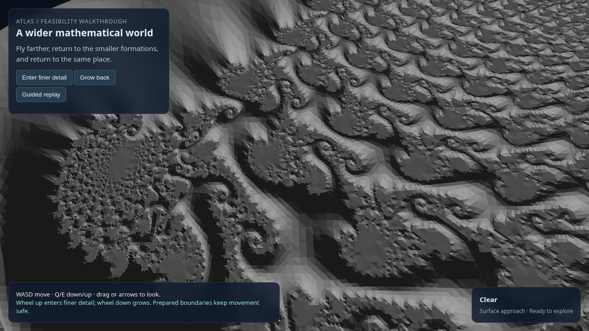

# BW1: a wider mathematical world prepared around the visitor

**The bounded wider-world experience works.** The browser now requests fresh regions from the visitor's position, travels beyond the old fixtures along two axes, contacts newly generated terrain, returns to the smaller mathematical formation and reconstructs the same places after retirement. A surrounding representation keeps the landscape visible while the visitor moves through locally empty air.

Three two-minute runs completed nine full excursions at **49.45 FPS**. Actual keyboard/mouse travel and fine-scale contact passed. Navigation p99 meets its target; maximum update time and preparation latency still miss theirs. Memory ownership remains unverified. These are measured limitations of a working local prototype.

Owner Codex; challenger Claude. Governing [North Star](../../superpowers/specs/2026-10-23-atlas-north-star-charter.md), [fixed-world interpretation](../../superpowers/specs/2026-10-29-atlas-multiscale-world-clarification.md), and [BW1 outline](BW1-NEXT-2026-10-29.md). This follows [PR9's local lifecycle](PR9-LIFECYCLE-2026-10-29.md). Product source and defaults are unchanged.

## Try it

Run `/mnt/ml_storage/scratch/atlas-bw1-preview/preview.sh`. It opens installed Chrome and starts the local preparer. WASD/QE moves; drag or arrows look; wheel/buttons change scale near the starting formation; Guided replay follows the tested route. Closing the window or Ctrl+C stops it; the launcher also has a 15-minute bound. Its start/close path was tested successfully.

The current interaction domain is a bounded lateral lattice, with a limited vertical extent. Finer interaction is available near the original formation. The prototype does not yet provide arbitrary three-dimensional coverage, finer structure everywhere, deployment or browser-only generation.

## What changed

The world remains `H1C-surface-child@ee2564d40bda7ef6`. No mathematical rule, amplitude, seed, material or light was changed for BW1. Body diameters remain26.5625 mm and 6.640625 mm.

Coarse region centres come from stable coordinates on a9 ×5 lattice, rather than a list of retained mesh fixtures. Spacing is 0.75 larger-body diameters along the original tangent/binormal frame; each world-axis-aligned cube has half extent one diameter. The visitor's actual pose and velocity drive requests. Outside supported coverage, movement is honestly withheld.

The coarse preparer evaluates the parent graph and cutters for the requested region, reusing correctly keyed mathematical source/topology caches. It no longer copies the finite parent-reference cube or offline coarse meshes. The existing canonical fine preparer remains the declared control at the starting formation. Preparing geometry and collision stays outside navigation updates.

The first 20-second smoke already crossed 12 handoffs and contacted new terrain, but its image was blank where the active local cube contained only air. We retained that positive preparation/physics result and added one explicitly bounded surrounding view representation of the same world. It has four times the larger-body diameter and half extent four diameters, with a declared coarser viewing tolerance. It never grants collision coverage. Rendering clips it outside the local interaction cube; in fine mode, the coarse home representation bridges between the fine cube and the broad view. GPU fixtures verify those masks.

View jobs bypass caches, preserving the full 96/32/64 MiB interaction cache budgets. They start only when the predicted interaction horizon is ready; queued interaction work has priority. Hysteresis prevents repeated view replacement near a boundary. An active native job remains nonpreemptive, so blocking is still possible and measured.

The scheduling approach follows the bounded observer-centred windows and incremental updates described in [GPU Gems 2, Chapter 2](https://developer.nvidia.com/gpugems/gpugems2/part-i-geometric-complexity/chapter-2-terrain-rendering-using-gpu-based-geometry). We reuse that principle without imposing a heightfield representation or mesh morphing on this composed world. No third-party implementation was imported.

## Full criteria scorecard

| Criterion | Target | Observed result |
|---|---|---|
| Fixed mathematical world | Stable lineage across location, scale and reconstruction | Met within this host and construction. Worker/content-ID assertions, representation-kind checks and captured source hashes pass. |
| Observer-driven preparation | Fresh regions beyond five old fixtures and along another axis | Met. All ordinary runs travelled beyond old index4 and sideways. Eighteen coarse addresses were exercised, plus the fine representation and two surrounding views. |
| Fresh parent and cutters | Actual construction for requested coarse coordinates | Met. Every completed coarse job uses the fresh parent/cutter pipeline; source arrays may be reused through declared caches. No runtime copying of qualified coarse meshes. Each ordinary run recorded116 new coarse source tiles after initial preparation. |
| Numerical/source domain | No unresolved required source samples | Independent CPU screen:183 unique tiles,12,086,967 source-resolution samples across all45 addresses, zero unknowns. Finite sampling, not an enclosure proof. |
| Local fidelity |≤0.01 current-body diameters | Sampled mesh/field agreement passes for all actual interaction representations. One region,143, had no exposed forward-reference samples; its completeness remains unsampled. Its mesh-to-field checks pass. No exhaustive topology claim. |
| Surrounding-view fidelity |≤0.01 ×4D=1.0625 mm; viewing only | Met in the performed checks. Reference→mesh maxima0.143/0.129 mm; corrected projection bounds0.199/0.194 mm; composed crossing bounds≤0.233 mm for the two actual contexts. |
| Empty-air publication | Explicit classification, no missing-data-as-air | Eight actual representations classified empty-air and checked with1,024 occupancy samples each. Synthetic full-solid and empty-world snapshot/inclusion fixtures pass. Thin unresolved features remain a sampling limitation. |
| Joins and coverage | Whole-body covered handoffs; sampled surface agreement | Actual oblique-lattice body bound0.9012D<1D. Two adjacent overlap checks pass at about1nm numerical disagreement. No general watertightness or seamless-horizon claim. |
| Entry and contact | Prepared/clear incoming body; no relocation; discrepancy≤0.01body |239 recorded entries pass preparation, coverage and independent finite body checks.75 contact events pass triangle-prefix/stop and mathematical crossing checks; crossing bound≤0.000313body diameters. |
| Full ordinary journey | Wider travel, new-terrain contact, smaller formation, retreat/grow/return | Nine complete excursions,21 contacts and196 activations across3 ×120 s; zero reported errors or boundary refusals. The21 contacts include12 coarse and9 fine events. |
| Reuse, retirement and reconstruction | Stable place after cache reuse and eviction |219 ordinary retirements. All 302 published instances across corpus/input reproduce 21 representations in NPZ arrays and published buffers. Same-host evidence only. |
| Opposite request order | Same new-region geometry in reversed order | Passed two fresh-worker orders and a repeated request against qualified originals. Separate from resident reuse. |
| Actual input | Two-axis movement, reversal, fine contact/retreat/look | Passed. Coarse keyboard flight went beyond the old corridor and sideways, then reversed. A separate explicit test reset preceded guided return and manual fine contact/retreat/look.52 held-W contacts are repeated queries, not52 discoveries. |
| Overall frame rate |≥30 FPS | **Pass:**49.45 FPS pooled; individual runs49.44/49.43/49.46. |
| Frame rate during preparation |≥30 FPS | **Pass:**49.46 FPS during native preparation,49.11 FPS through all pending preparation. |
| Navigation update | p99≤2 ms; maximum≤8 ms | **p99 pass:**1.8 ms pooled. **Maximum miss:**12 ms; individual maxima12/11.5/10.9 ms. Phase timers place the largest cost in a coarse prepared collision sweep, max11.9 ms. |
| Fine-query tail | Report separately from pooled workload | Fine sweep p99 remains about3.5 ms. The overall p99 pass is a different workload mix, not evidence that this fine-query cost was optimized. |
| Request→ready |≤1 s, separately by representation | **Miss:** coarse0.592–2.315 s,110/198 over1 s; fine1.559–1.698 s,9/9 over; views1.917–2.228 s,21/21 over. Native process/kernels are warm, fields reset each run. |
| Ordinary waiting | Durations reported; no post-run zero-wait gate |6.6905 s across 360 s. Measured coarse-wait wall intervals overlap active native view work by about47 ms in total; view generation alone does not explain the waits. |
| Late preparation | Safe withholding followed by recovery | Forced3 s dispatch delay produced2.9001 s of waiting, followed by resumed movement and new-terrain contact; no errors. The20 s control does not establish a complete return cycle. |
| First usable world | Report startup scope | Browser setup→ready3.108 s; whole measured process→ready4.889 s. Includes initial surrounding view. Not a cold-cache product startup qualification. |
| Frame tails | Diagnostic, not extra acceptance gates | p95≈20.1 ms; maxima120–160 ms. Publication-tail measurements reach144–190 ms, but the precise cause of each long frame is not isolated. These brief stalls remain visible performance work. |
| Residency and caches | Four interaction regions; one published view/transient replacement; bounded caches | Observed bounds pass: peak4 interaction regions, transient2 view buffers, one selected for rendering. View jobs caused zero interaction-cache evictions. Individual view geometry stays below64 MiB. |
| Region working set |≤1 GiB attributable CPU+GPU data | **Ownership unverified.** Native RSS peak1,149 MiB, owned process-tree peak3,201 MiB. Main/worker WASM capacities≈350.5/130.8 MiB, GPU peak65.1 MiB, transfer peak60.9 MiB. These categories overlap or omit ownership and must not be summed into a pass. |
| Execution and cleanup | Bounded work, exclusive GPU, hardware profile/sandbox, confirmed cleanup | Performed runs pass. Installed headed Chrome/NVIDIA RTX 6000 Ada profile; shader and nesting controls pass. All 28 recorded corpus/input PIDs absent; separate native workers, mask fixtures and launcher stop cleanly. |

The audits check a single fixed feature and finite coverage. They do not establish arbitrary recursion, cross-platform bitwise identity, complete surface enclosure, long-session memory stability or a finished browser-ready world.

## Review and validation corrections

Claude card review `20261029T211923Z-45d976` caught origin validation, region classification, domain and cache-lineage issues before GPU preparation. Focused review `20261029T213835Z-1738e8` supported the surrounding-view correction and required scheduling, cache protection, hysteresis and nested masking checks.

The first evidence-review attempt exceeded the bridge's1 MiB image-message limit. The failed attempt and original PNGs are preserved. Text-only retry `20261029T221245Z-a910fe` found no material safety, identity or lifecycle defect and supports moving toward browser-application preparation contracts. It checked source/method/summary consistency, had no shell, did not independently recompute raw timing and did not judge the PNGs. Visual support comes from the preserved captures, owner/advisor observation and same-shader GPU controls; it is not labelled an independent peer image certification.

The initial reverse-reference helper used the wrong outward direction for cutter caps: the correct direction is −n. This omitted valid cap references and produced a loose12.64 mm bound for one context. Correcting it gives0.199 mm on the same samples, without changing geometry or tolerance. A diagnostic helper also initially omitted the world-origin translation; that failed attempt is retained. Normal-line checks then handled five thin, multiple-crossing cases that endpoint-only brackets could not establish. The final actual-mesh checks use correct cap orientation, projection and composed occupancy crossings. Region143's missing forward-reference sample remains explicitly unresolved rather than being hidden by an overall pass flag.

## What this unlocks

The prototype has moved beyond replaying a handful of prebuilt fixtures: preparation now follows coordinates in a larger mathematical place, supplies interaction data, preserves finer local content and survives reconstruction. The surrounding scene remains visible through empty air. This is a world-foundation milestone, with the next risks now at coverage, preparation contracts, resource ownership and integration.

Next, define a browser-facing preparation contract with stable world/representation identities, explicit viewing-versus-interaction eligibility, ready/error/unsupported states and ownership. Carry the measured native preparer as the control, extend coverage beyond the present lateral slab, and integrate only after those contracts are exercised. Browser-side generation versus a preparation service remains an explicit future decision.

Avoid a general optimization detour. Carry the measured gaps into that next work: coarse collision-sweep outliers, preparation throughput/prediction, WASM capacity over longer sessions, and publication cost. View-only data currently travels through the reused collision-index/snapshot pipeline; separating that payload and moving face-normal expansion away from the main thread are plausible improvements, not isolated performance findings from this experiment.

## Evidence and process cost

Cards, CPU screens and qualification: `/mnt/ml_storage/scratch/atlas-world-bw1/`. Preserved initial runtime: `/mnt/ml_storage/scratch/atlas-bw1-runtime-r0/`. Measured current runtime, scores and audits: `/mnt/ml_storage/scratch/atlas-bw1-runtime-r1/`. Launcher and verification: `/mnt/ml_storage/scratch/atlas-bw1-preview/`.

Main evidence includes `source-domain-r0.json`, `preflight-r0.json`, `mesh-qualification-r0.json`, `overlap-r0.json`, `order-identity-r0.json`, view preflight/diagnosis files, `full-r1.json`, `input-r1.json`, `score-r1.json`, `runtime-audit-r1.json`, `actual-mesh-qualification-r1.json`, `clip-controls-r1.json`, frozen source hashes and closure manifests.75 contact events,239 entries and302 instances were checked; eight empty-air regions have sampled confirmation. No complete-world topology proof follows.

Work began around 21:11UTC and closed around 22:18UTC. The body-only smoke succeeded before the explicit surrounding-view amendment. The view correction, reference-helper diagnosis, full corpus, actual input, audits and reviews remained within the recorded bounds. No completed performance run was repeated to improve its verdict. Domain/classification/card challenges and actual-shader controls were useful. The validator mistakes and image-transport retry were process costs; neither was hidden as a world-generation failure. Product source was untouched, so no product acceptance gate was substituted for the bounded scratch evidence. No commit, push, merge or product default change occurred.
