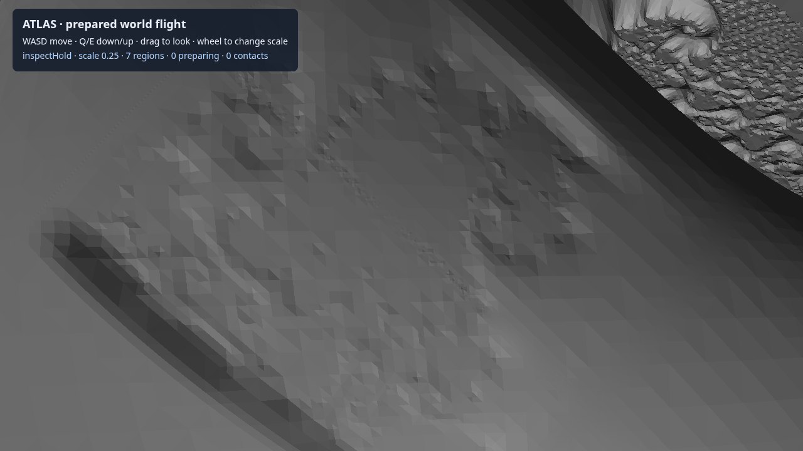
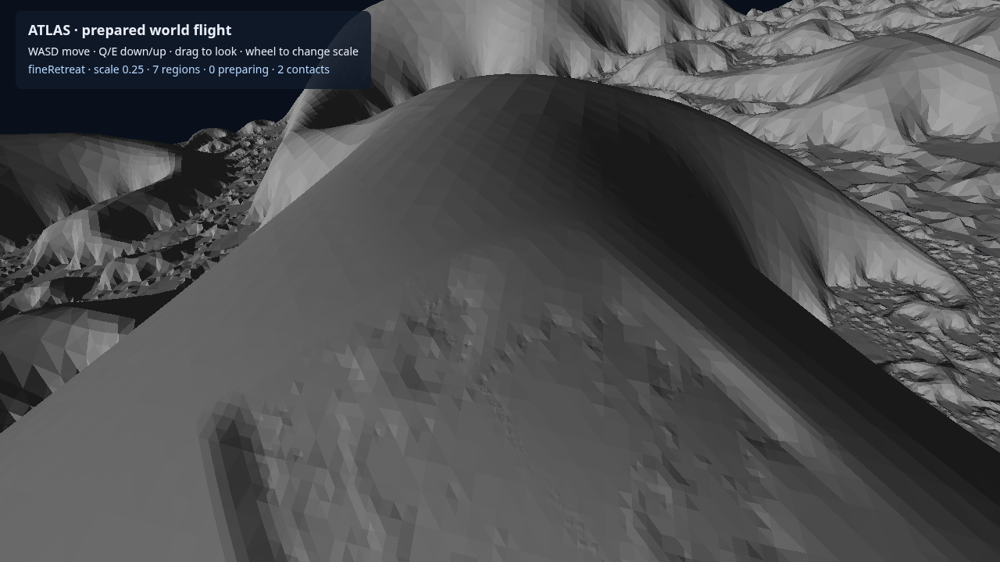

# PC2 / WC2 — live prepared 3D flight

**Owner result, 2026-10-29.** PC2 demonstrates the bounded experience: live preparation through PC1, ascent/descent into new 3D coverage, lateral travel and reversal, prepared terrain contact, and repeated visits to the original smaller mathematical formation. The three 90-second ordinary runs achieve **49.97–50.01 FPS**, exceeding the frozen 30 FPS target overall and during preparation. Preparation latency, navigation tails and complete memory ownership remain gaps. This is progress toward the North Star's inhabitable mathematical world; BI1 application integration is the next step.

The [design](../../superpowers/specs/2026-10-29-atlas-pc2-live-3d-coverage.md), [implementation plan](../../superpowers/plans/2026-10-29-atlas-pc2-implementation.md), [frozen card](PC2-CARD-2026-10-29.md) and [card r1 corrections](PC2-CARD-AMENDMENT-2026-10-29.md) govern the result. Claude card challenge `20261029T234230Z-92ad1a` preceded implementation. Independent evidence reviews `20261030T011025Z-385c2e` and `20261030T011346Z-e15ebe` support the bounded result and proceeding to BI1 design.

## Full frozen scorecard

| Criterion | Result | Evidence and limit |
|---|---|---|
| World identity and reconstruction | **Pass, bounded** | Canonical `H1C-surface-child@ee2564d40bda7ef6`, definition key `fnv1a64:4c29d6f7f61fbb06`, explicit lineage, 22 source digests, actual sampling policy and retained fine-parent digest. Fresh producer builds fine before home and reproduces the original binary identities. Resident reuse, actual rebuild after retirement and stale-epoch rejection pass separately. Workstation-specific dependency installation remains open. |
| Live 3D experience | **Pass, bounded** | All three ordinary runs enter `k≠0`, ascend and descend, move laterally and reverse, and complete 4/3/3 full excursion/fine-return cycles. Each makes four fine visits and four coarse plus four fine contacts. Actual input passes in 26.121 seconds, including Q/E, lateral keys, a measured 1.500D coarse reversal, wheel shrink, fine contact, growth refusal, retreat and mouse look. |
| Contact and transitions | **Pass in finite checks** | 201 actual handoffs and 98 contact events independently checked across ordinary, late and input runs; all checked body samples at handoffs are air. Contact-prefix clearance stays at least 0.5 body units; mathematical contact crossings are within 0.000313 body diameters, below the 0.01 tolerance. Recorded rendering/interaction keys agree; scale changes have zero displacement. Delayed movement remains stationary until prepared coverage becomes usable. No global topology/enclosure claim. |
| Qualification | **Pass in sampled scope** | All published unique geometry is covered by 16 qualified representations including preflight: six surface/view specimens and ten distinct air specimens as detailed in the JSON, with no unqualified final-smoke representation. Every surface uses 512 reverse samples; air specimens use 1,024 occupancy samples. One new coarse surface has only one forward sample: this is limited finite evidence. Original fine arrays match the control exactly. Original region143 now has three forward samples within tolerance, preserving the earlier zero-reference finding and reverse evidence. |
| Frame rate ≥30 FPS overall and during preparation | **Pass** | Ordinary overall 50.006 / 49.983 / 49.972 FPS; preparation 50.007 / 49.976 / 49.961. Late control 50.051; input 49.982. Ordinary maximum frame intervals 20.1 / 40.1 / 40.0ms are diagnostics, with no additional frame-tail gate. |
| Navigation p99 ≤2ms, max ≤8ms | **Miss** | Ordinary p99 2.2 / 2.2 / 2.1ms; maxima 4.3 / 4.5 / 4.6ms. Input p99 4.5ms, maximum 9.9ms. Coarse aggregate p99 0.9–1.1ms; fine steady p99 3.5–3.7ms. First fine movement casts after preparer warmup are ≤0.1ms; un-warmed restoration is timed separately. Coarse “first” telemetry mixes constant-air decisions with first surface casts, so an isolated coarse first-cast distribution is unverified. |
| Readiness/throughput, interaction target 1s | **Miss; safe recovery passes** | Ordinary interaction medians 1.473 / 1.378 / 1.449s, maxima 2.400 / 2.350 / 2.424s. Ordinary movement waits 11.860 / 13.180 / 13.540s per 90-second run. The 3-second gate produces a 3.011s readiness maximum and 4.100s total waiting in its 20-second run, followed by resumed 3D travel and fine contact. All queue/transfer/index/restore/upload/publication time is included in readiness. |
| Resources and recovery | **Bounds/cleanup pass; 1GiB ownership unverified** | One active native job, at most two queued, at most eight owned interaction regions including retirement, interaction priority, and protected fine/home dependency. All 158 full-workload publications retire. Source/validation/topology cache peaks 100,394,480 / 80 / 67,108,280 bytes stay within 96/32/64MiB caps; view causes no interaction-cache evictions. Full workload preserves 229 native records and 706,110,192 output bytes, below 512/4GiB. Peak tracked GPU data about 35.9MiB; main/worker WASM capacities about 39.5/94.2MiB. Whole owned-process RSS peaks at 2,862.7MiB; this is not attributable region memory. Native/driver allocator ownership remains incomplete. All recorded owned PIDs stop. |
| Process and compatibility | **Pass with source-scope limit** | 1,258 registered guarded units and static build pass. Headed installed Chrome, sandbox, Vulkan launch profile and NVIDIA RTX 6000 Ada identity recorded; exclusive lock, explicit handoff and bounded cleanup used. The full/input measured source is preserved; final dependency injection has a separate headed smoke. Three exact-final-packaging repeats were not run. Independent source/evidence/image judgement supports this scope; the reviewer executed nothing. |

Qualification is empirical. Counts, classes and all declared tolerances are in [the preserved evidence summary](PC2-evidence-summary-2026-10-29.json), with [explicit sparse-reference annotations](PC2-QUALIFICATION-LIMITS-2026-10-29.md); a missing or sparse reference set is not a completeness proof. Live admission carries zero instance sample counts, the preflight policy certificate and explicit empirical limits. Post-run qualification is reported separately and never presented as work completed at runtime admission.

## What changed

The new 3D half-D lattice provides stable addresses and whole-body/sweep enclosure inside explicit returned cubes. Native generation wraps the immutable canonical builders and exports explicit surface/air/full-solid classification with strict structural, source, policy and binary checks. CPU units test coverage, cancellation, scheduling and ownership; independent CPU mathematical checks run offline. GPU mathematical evaluation remains in the retained generator, compiled native code constructs meshes, WebGPU renders them, and prepared compiled WebAssembly collision structures answer navigation queries. Navigation performs no field evaluation or mesh construction.

The browser waits for both rendering and collision resources before PC1 interaction readiness. Worker transfer, snapshots, GPU allocations and payload leases have explicit release paths. View intent skips solid-buffer transfer and collision preparation. Incoming clearance and sweeps use actual prepared geometry; no flat-terrain assumption is made. Prediction uses a bounded 2–4-second horizon and at most three ahead addresses. Fine/home dependency stays protected. The existing Plane/Space application composition is not yet integrated.

## Where latency goes

Across full-run setup, ordinary and late observations, fine interaction has median readiness 1.928s: native work 1.078s, front queue/admission 0.703s and worker work 0.113s. Coarse surface medians are 1.471s ready, 0.668s native and 0.191s front queue. Explicit air still costs 0.916s native at its median because this retained method constructs/classifies before learning the result is air. Surrounding view native work has a 1.724s median. Six published coarse-air requests arrive during an active nonpreemptive view job; queued interaction still wins subsequent dispatch.

These are marginal medians and do not add to a single representative request. Native timings include structural admission checks; surface structural checks can cost about 0.38s. The producer, queue and construction method account for much more than snapshot restoration or GPU upload. This identifies optimization work without changing the world or moving mathematical discovery into navigation. Preserve this native method as the control while BI1 establishes the browser application slice.

## Attempts and final-source scope

`browser-full-r0` completed one valid 90-second run, then exposed a cancelled-response publication leak at reset. The [bounded repair](PC2-MECHANICAL-REPAIR-2026-10-29.md) adds request-identity retirement for clients that never acquired a response token. `browser-full-r1` then completes the entire frozen workload. Both attempts and earlier development failures remain preserved.

The full unit gate subsequently caught the experimental dynamic physics import in Space core. [Final dependency wiring](PC2-DEPENDENCY-WIRING-2026-10-29.md) moves that loader into the fixture, retaining the numerical, navigation and rendering behavior. Final wiring passes all units, build and a separate 20-second hardware smoke. The full/input measurements describe the preserved measured source; the final packaging has this narrower hardware check. They are not combined into an exact-final-head full-workload claim.

## Evidence, judgement and next action

Formally established within the tests: strict contract/lifecycle behavior, 3D cell enclosure and guarded unit compatibility. Supported by finite hardware/reference evidence: the live bounded experience, sampled geometry/contact agreement, stable reconstruction and bounded scheduling/retirement. Unresolved: complete memory attribution, portable backend installation, all-455-address behavior, an un-warmed coarse first-query distribution, exact-final-packaging repeat measurements and product acceptance.

Decisive artifacts are under `/mnt/ml_storage/scratch/atlas-pc2/`: `native-smoke-r0`, `browser-full-r0`, `browser-full-r1`, `browser-input-r0`, `reconstruction-r0`, `region143-r0`, `browser-wiring-r0`, `measured-source-r1` and the review packet. Each run preserves input/source hashes, producer/epoch records, payload descriptors, measurements and cleanup. The summary and representative images are archived here; large native buffers stay in scratch.

Claude independently supports closure and proceeding to BI1 design, with readiness throughput explicitly owned and final application behavior qualified on BI1's own final source. He viewed both archived images, read the summary/repair notes and cancellation/reconstruction source, and verified the runtime-admission example in follow-up. He executed nothing and did not review the three preserved measured files line by line. His initial 4/9 coarse surface/air count was checked against the data and corrected to 3/10. The sparse-reference annotation and bounded ownership of cancelled output evidence resolved his two requested clarifications. Verbatim exchanges are in the milestone codesign log.

The owner supports proceeding to **BI1's integration design and task plan**, carrying latency, query-tail and ownership gaps as explicit obligations. The bounded flight experience is demonstrated; the full set of performance/resource targets is not met. BI1 must respect retained workspace/history/camera/recovery contracts and qualify its own final application behavior. Its early slices must own truthful waiting/readiness throughput and preserve the measured native control. No production backend or release default is selected here.

Implementation began about 23:53 UTC and final wiring checks finished about 01:04 UTC, roughly 71 minutes, with workload execution overlapping implementation. Design/independent card review preceded that clock. The repeated hardware workload, cancellation repair, full boundary gate and finite contact audit were useful; duplicating the same complete run after a dependency-only packaging change was not pursued. Evidence review/report/publication work took roughly another 15–20 minutes, within the separate one-hour allowance; normal peer review plus one focused clarification was useful. No new visual gate or backend search was introduced.
