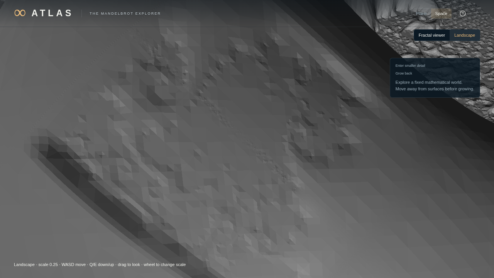
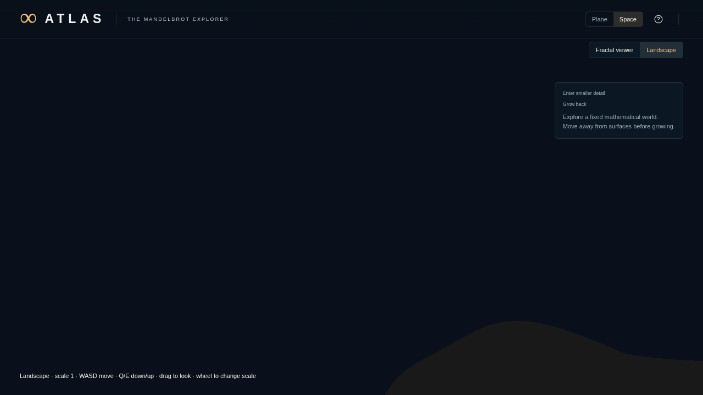

# PC3 / BI1.A1 — prepared Landscape inside ATLAS

**Owner result, 2026-10-29; independently reviewed.** ATLAS now opens the prepared mathematical landscape through its actual application, with explicit Fractal viewer/Landscape modes inside Space. Real movement, contact, smaller mathematical detail, safe growth refusal and leave/return to the retained pose work in the bounded world. The product gate passes on the pinned implementation. Claude supports bounded closure and proceeding to A2 in review `20261030T033633Z-411dc5`. This closes the implemented first application slice; it does not close all of BI1 or meet every performance target.

Implementation, design, plan and evidence are published in [PR #20](https://github.com/Silicon-Wraith/atlas-explorer/pull/20), open for advisor review/merge.

Governing [design](../../superpowers/specs/2026-10-29-atlas-bi1-application-integration.md), [task plan](../../superpowers/plans/2026-10-29-atlas-pc3-bi1a-implementation.md), [frozen r0 card](PC3-CARD-2026-10-29.md) and [r1 amendment](PC3-CARD-AMENDMENT-2026-10-29.md). Claude's card challenge `20261030T014341Z-f372da` preceded implementation. The amendment narrows PC3 to **BI1.A1**: validated in-memory pose and explicit client close. Abrupt-client expiry/multi-tab recovery are BI1.A2; persistent scene/history/file workflows are BI1.B; complete device-loss recovery is BI1.C.

## Full frozen scorecard, with r1 scope

| Criterion | Result | Evidence and limit |
|---|---|---|
| Application entry | **Pass, local development control** | `npm run dev:world` opens the actual ATLAS application at one localhost URL, with lazy native preparation. The launcher owns the lock, headed browser, server and shutdown. Static-only launch reports an actionable preparation reason and falls back to the viewer inside Space; Plane remains accessible. Dependencies still use the documented workstation-specific native/physics bundles. |
| World and pose | **Pass in A1 scope** | Original `H1C-surface-child@ee2564d40bda7ef6`, definition `fnv1a64:4c29d6f7f61fbb06`, lineage and 22 canonical source digests retained. Finite immutable Y-up metre pose validates origin, local offset, orientation, FOV and D/D4 body scale. Numerical conversion tests use the actual origin/body skin. Re-entry preserves the exact pose. The persistent scene codec and its user-facing JSON workflows are deferred by r1. |
| Flight and contact | **Pass in finite checks** | One actual-key route completes in **22.804 s** against the 90 s bound: ascent/descent across `k≠0`, lateral/reverse, shrink, fine contact, unsafe growth refusal, retreat/growth and return. Offline checks cover 11 handoffs, 30 contacts and 867 recorded frames; 59 waiting frames remain stationary. One active region supplies rendering and collision by construction; matching logged keys are not an independent visual check. Scale changes have zero displacement. All 27 body samples at each checked handoff are air. Contact-prefix clearance stays at least 0.5 body units; mathematical crossing bounds are within the declared 0.01 tolerance. No global enclosure/topology claim. |
| Activation/input | **Pass within tested scope** | Registered deferred lifecycle controls and the actual 30.347 s rapid-switch control suppress stale activation/presentation. Input ownership closes synchronously; new activation waits for first current presentation. Blur/visibility/dialog eligibility and pointer release have source/unit coverage; exhaustive browser testing of every combination is not claimed. |
| Leave/re-entry | **Pass, supported in-memory pose** | Actual viewer→Landscape and Plane→Landscape returns preserve the pose exactly; Plane scene stays unchanged. Re-entry waits for release and new clearance. No silent reset. The 30.001 s pending-response control also re-enters at the retained pose. Saved-world/history UI and full device-loss parity remain later BI1 slices. |
| Preparation ownership | **Pass in A1 scope** | One client cannot take over another; same-origin JSON POST, Host/Origin and private-path controls pass. The pending-response control holds a real prepared HTTP200 response while the browser still lacks its token, then closes the client; native publications fall to zero before re-entry. All 18 native publications retire. Nine server AbortError records are expected cancelled native requests; there are no page/runtime/device/cleanup errors. Abrupt client loss is owned until launcher shutdown; expiry is explicitly deferred. |
| Frame rate ≥30 FPS overall/during preparation | **Pass for active Landscape** | **49.943 / 49.877 FPS**, calculated from 867 active-Landscape frame intervals. Maximum interval40 ms is diagnostic. Initial activation and mode/workspace waits are measured separately, not included in active-frame FPS. This is one short actual-input route, not PC2's three90 s repeat workload or an application-wide FPS measurement across other modes. |
| Navigation p99≤2 ms, max≤8 ms | **P99 miss; maximum pass** | 730 movement decisions: p99 **4.200 ms**, maximum **4.800 ms**. Constant-occupancy decisions p99 0.200 ms; three first-surface decisions maximum0.300 ms; steady-surface p99 4.200 ms. The three first-surface observations are a small warmed sample, not an un-warmed guarantee. Preparer warmup/restore remain outside movement timing. |
| Readiness/throughput target1 s | **Miss; truthful waiting passes** | Nine route interaction receipts: median **1.102 s**, maximum **2.453 s**. Two view receipts: 1.728/1.776 s. Movement waits1.180 s, **6.80% of recorded active-Landscape time**. Initial activation takes3.843 s; subsequent successful activations2.581–2.711 s. PC2's13–15% waits are context only: this shorter route does not establish a throughput improvement. Speed, tolerance and world are unchanged. |
| Resources/qualification | **Bounds and finite qualification pass; 1 GiB attribution unverified** | Peak observed interaction ownership8, view1, tracked GPU data30.92 MiB. Source/validation/topology peaks100,394,480/80/53,848,752 bytes remain within96/32/64 MiB caps.22 native records and100,935,965 output bytes remain below512/4 GiB. All9 unique delivered representations qualify: five surface/view, four air. One coarse surface has only **one forward-reference sample**, with512 reverse samples; each air specimen has1,024 occupancy samples. Original fine arrays match the control. Main/worker WASM capacities102.75/76.63 MiB; whole owned-process RSS2,912.24 MiB is not attributable region memory. Live admission retains honest zero instance sample counts and the preflight policy certificate; post-run qualification is separate. |
| Existing behavior/process | **Pass on pinned implementation** | **1,279 registered units in79 files**, build, complete numerical reference regeneration, maintained Plane browser/workflow/navigation/graphics, headed hardware and Space coexistence/recovery/numerics/rendering/shell/interaction, three viewer performance scenes, cold prewarm and prepared application suite all pass. Installed sandboxed headed Chrome155, maintained Vulkan/WebGPU arguments and NVIDIA RTX6000 Ada recorded. Exclusive lock/handoff, bounded execution and independent host closure audit confirm owned PIDs absent, ports closed and lock free. Independent evidence review supports the bounded result, with source scope recorded below. |

## Source, implementation and evidence

All application measurements and the full gate use implementation commit **`bb1d52814a7b15bbbd797276bbc376d3a6ed6440`**, based on merged PR19/main `9bd2066a9aaaf935f6740944ec9cdac02790eb03`, in `/mnt/ml_storage/dev/projects/mandelbrot_explorer/.worktrees/pc3`, branch `feat/pc3`. All19 source digests recorded by the final application suite match the checkout. Subsequent closure documentation does not change the measured implementation.

The composition root injects the lazy physics loader and product worker URL; Space core keeps its import boundary. A DOM-independent prepared runtime owns requests, residency, prediction, safe contact/scale selection and retirement. A mode host coordinates the retained existing viewer and the Landscape workspace. Rendering uses an owned WebGPU device released on leave. Compiled WebAssembly collision consumes prepared geometry; navigation performs no mathematical field evaluation or mesh construction. The original native generator and Python mathematical source remain unchanged as the control.

The local same-origin host initializes preparation lazily, guards client identity and owns cancelled requests independently of response-token delivery. Static private paths stay blocked. A cached WASM module's live memory remains observable across workspace re-entry, including an air-only re-entry, without relying on its initializer running twice.

The full gate runs from02:59:56–03:30:10 UTC on2026-10-30 (local2026-10-29). [Archived gate record](PC3-product-gate-2026-10-29.json), original `artifacts/gates/2026-10-30T02-59-56-774Z-bb1d52814a7b.json`. The gate starts at a clean commit; the maintained performance harness writes tracked documentation during the run. Each completed report was copied byte-for-byte to `/mnt/ml_storage/scratch/atlas-pc3/compatibility-r0/`, then the prior pinned documentation copy restored byte-for-byte; the newly generated prewarm file was moved there. The [relocation ledger](PC3-output-relocations-2026-10-29.jsonl) records hashes and the correction of an initial ignored/untracked label. No measured application source, input workload or outcome changed. The final gate sees the same clean source commit. Future runs should set `ATLAS_B15_REPORT_DIR` to scratch directly.

Decisive artifacts: `/mnt/ml_storage/scratch/atlas-pc3/application-r0/` contains browser/source/input events, native records/buffers, score, nine-specimen qualification, exact buffer audit, flight audit, screenshots and host closure. CPU mathematical qualification takes14.44 s and the flight audit1.78 s, outside runtime readiness. All17 consumer observations retain phase timings; maxima include330.10 ms collision preparation,81.20 ms snapshot restoration,67.30 ms normals,20.90 ms upload and1.50 ms warmup. Marginal timings do not add to one representative request.

## Attempts, limits and next action

Native/HTTP and headed application development smoke tests preceded the final run. Launcher development attempt `launcher-r0` exposed Playwright's default Ctrl+C process exit bypassing the application's final closure report. Host inspection found the launcher/browser stopped, no native output, and port/lock released. The bounded repair disables Playwright signal ownership and handles shutdown in the application; `launcher-r1` records successful closure and an independent host audit confirms it. These development attempts remain preserved. The frozen final application workload passes on its first attempt; no repeat was used to improve its score.

Formally established within tests: validated pose/ownership contracts, deferred lifecycle behavior, guarded source boundaries and the pinned maintained gate. Supported finite findings: actual application flight/contact, retained safe return, sampled geometry agreement, explicit close/lost-token retirement and observed frame rate. Unresolved: complete memory attribution and long-session WASM capacity, readiness and navigation-tail targets, portable/browser-only preparation, all455-address behavior, abrupt-client recovery, saved scenes/histories and full device-loss parity.

Claude independently read the owner report, full score/lifecycle summary, gate pass/state fields and the request/retire/select/re-entry portions of `runtime.js`; he viewed both fixed images and executed nothing. He did not read workspace/mode-host, server/client/policy, WASM memory or launcher source beyond recorded hashes. His support is limited to that scope. He confirmed the finite counts and remaining misses, requested the corrected post-return image caption and construction-versus-independent-evidence wording, and recommended putting sparse forward counts into qualification records when that tool is next changed. The raw qualification record currently says `limits: []` for the one-forward-sample surface; [the archived annotation](PC3-QUALIFICATION-LIMITS-2026-10-29.md) and evidence summary explicitly narrow it without rewriting the original run. His discussion of that limit does not make it a completeness proof.

The next owned slice is **BI1.A2**: bounded recovery from abrupt client loss and an explicit multi-tab policy, preserving this measured native control. BI1.B then makes the retained place a supported save/reopen/history experience; BI1.C completes interruption/recovery qualification. Do not reopen geometry/backend selection to disguise performance gaps.

Implementation/CPU work begins about01:49 UTC and reaches the pinned commit by02:59, about70 minutes within its three-hour bound. The required full product gate costs30.23 minutes, including the unchanged CPU reference and viewer workloads; the new browser workload itself costs111.15 s plus offline audits. The broad gate is useful because application composition changed. Card challenge, cancellation/source controls and finite independent geometry checks address the actual risks; extra artistic gates and repeated runs for cleaner scores were unnecessary. One normal evidence review and closure/publication take about15–20 further minutes, within the separate one-hour evidence bound; no additional review round was needed for the wording corrections.

