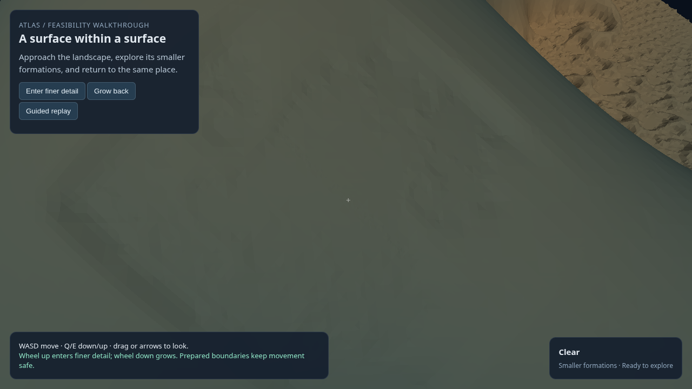
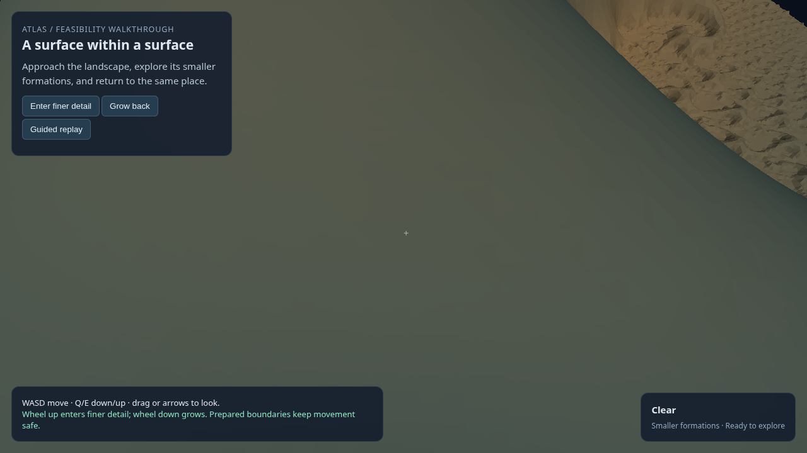

# PR8: fixed-world mathematical construction and interaction

**Partial result: mathematical generation and local interaction work; the recognisable-formation criterion remains unmet. The declared visual stop was triggered.** No full performance campaign followed the failed visual gate, and broader BW1 implementation remains deferred.

Plan: [multiscale feature experience](../../superpowers/plans/2026-10-29-multiscale-feature-experience.md). Governing design: [North Star](../../superpowers/specs/2026-10-23-atlas-north-star-charter.md), with the [owner's corrected engineering interpretation](../../superpowers/specs/2026-10-29-atlas-multiscale-world-clarification.md). Owner Codex; challenger Claude. Scratch root: `/mnt/ml_storage/scratch/atlas-multiscale-pr8/`. Product source, existing worlds and PR1–7 artifacts remain unchanged.

## What was built

The fixed H1C parent/child/grandchild construction was checked first. Its recorded grandchild anchor reconstructs exactly on the generated child floor, and the recorded world version reproduces. Of 65 original opening-route centres, 56 are solid in the offline no-grandchild counterfactual and air in the full construction. The opening is a genuine mathematical contribution, but already exists in the old qualified mesh. Rerendering it would not demonstrate new generation.

A new, explicitly versioned experimental world adds one mathematical descendant on the actual generated grandchild surface. Its canonical chart address is fixed before either observer request. It does not use a tangent plane or transient mesh triangle as the domain. For local coordinates u,v, the new floor is the old generated floor minus a bounded Mandelbrot-derived relief kernel. The kernel is K2's mathematical window mapped to 1/64 of its in-plane size, with amplitude 1/375 of K2's. This is an **anisotropically scaled relief copy**, not isotropic H1C recursion, deeper Mandelbrot zoom, or an arbitrary-depth generator.

The world identity is `H1C-surface-child@ee2564d40bda7ef6`. It includes construction/source/base-artifact hashes, chart address, formula and constants. The observer requests D=0.0265625 m and d=D/4=0.006640625 m; those dimensions select representation and interaction requirements, not the mathematical world.

One new fine candidate was built: 26,155 vertices and 51,275 real surface triangles. A same-resolution no-descendant mesh is an offline visual attribution control, never the ordinary navigation world. The existing coarse mesh was freshly checked as an approximation of the new full world at the larger body size.

## Frozen attempts and corrections

The first mathematical rule, r0, shortened the decay length at an ordinary off-boundary parent location. Its maximum contribution was 0.259 micrometres, below the declared 100-micrometre screen; its untapered modulation span was 0.001115 against 0.1. It was rejected before any mesh or browser run. Its inputs and results remain preserved.

The distinct r1 rule changes the mathematical domain mapping. It was proposed knowing why r0 failed and frozen before evaluation. Claude's card review `20261029T192410Z-9bd9ab` accepted it as a meaningful bounded discriminator, subject to corrections. Before r1 evaluation, amendment r2 reduced the fine region, used an actual collision-derived approach, propagated content identity through caches/registries/descriptors, clarified the visual measure and required independent full-world reference checks. The rule, amplitude, seed, scales and acceptance thresholds were not tuned after r1 outcomes.

The old-body approach uses the real coarse collider. A second coarse sweep supplies a fixed inspection pose. The fine region is centred between the approach entry and the mathematical feature, with physical half extent 0.5D=2d. Whole-body checks use that actual extent. Final contact follows the same segment using the new fine collider. There is no prescribed tangent-plane camera and no camera search.

## Full criteria scorecard

| Criterion | Target | Result |
|---|---|---|
| Genuine mathematical contribution | Fixed construction, finite independent reference and solid-to-air witnesses | Met locally: 4,225 grid plus 512 heldout samples; zero required unknowns; 4,388 declared contribution witnesses. |
| Nondegenerate descendant | Untapered span ≥0.1; maximum depth ≥100 µm | Met for r1: span 0.8513; maximum depth 200 µm. r0 remains rejected. |
| Domain, nesting and exposure | Child on generated surface, inside supported parent domain; subtractive ordered floor | Met within this construction: child support in flat parent taper; new floor never above old floor; all active sampled parent points exposed. Algebraic nesting is separate from mesh qualification. |
| CPU implementations and GPU parity | Consistent rule and resolved values | Independent scalar/builder difference ≤1.39e-17 m on the CPU screen; fixed GPU parity error 3.46e-8 m, no unknowns. |
| Coarse fidelity against the same full world | Sampled error ≤0.01D=265.625 µm | Met: 607 reference points, maximum 184.63 µm; 512 mesh samples, exposed-graph upper bound maximum 196.45 µm. |
| Fine fidelity against the full world | Sampled error ≤0.01d=66.406 µm | Met: 679 reference points, maximum 8.50 µm; 512 mesh samples, upper bound maximum 6.84 µm. Not an exhaustive topology or arithmetic proof. |
| Build validity and resources before browser | Resolved source/native validity, retained-parent coverage, component vertex guard | Passed local build gates; representative preflight estimate 495,264 versus hard 2,000,000 component-vertex bound. Final mesh has 26,155 vertices. |
| Runtime/offline identity | Same arrays with dense qualification enabled/disabled | Met: vertices, all triangles, collision triangles and origin are bitwise identical in the preserved cold-process builds. |
| Cache/content separation | Supported control/new tiles differ; disjoint tiles identical; content lineage in keys | Met in fixed within-process test; identifiers propagated through field/validation/topology caches, tile registries and server descriptors. |
| Approach and inspection safety | Actual collision-derived entry, covered body and clear path | Met for the local specimen: old entry clearance 0.50205D; incoming inspection clearance 0.58593d; fine approach sweep clear. CPU samples: 2,145 body points, zero solid/unknown; all 65 sampled profile rays clear. Sampling alone is not a whole-world guarantee. |
| Contact with descendant geometry | Actual witness within child support; ≤0.01d discrepancy | Met: prepared witness lies in the child support; independent mathematical contact gap 1.34e-8 m. Triangle-prefix and smoke contact checks pass. |
| Geometric visibility screen | Exposed profile attribution ≥4 px, support span ≥16 px | Met: maximum 25.11 px, support span 852.58 px; actual fine mesh sees all 65 profile points within declared approximation tolerance. This is the mathematical rule versus its offline counterfactual, not coarse/fine approximation error. |
| Recognisable formation and image corroboration | Named formation apparent in matching full-frame/128 px ROI evidence | **Unmet.** Relief/shading differences exist, but neither peer identifies a convincing formation; the crosshair ROI is unpersuasive. Numerical separation does not establish perceptual discovery. |
| Headed journey and safe transitions | Approach, shrink, contact, retreat, safe growth, rebuilt return; no errors or relocation | Supported smoke result: 3 contacts, 6 activations, 3 completed cycles, 3 unsafe-growth refusals, 1 retirement/rebuild, zero errors/boundary refusals. Independent checks of actual contact prefixes, entries and saved mesh identity pass. Full ordinary corpus not run. |
| Resident reuse and regeneration | No resident reevaluation; evicted geometry rebuilt consistently | Supported smoke: resident-reuse event; rebuilt fine geometry used zero new field calls; both generated fine job arrays match qualified geometry and world identity. Standalone cold runtime/offline identity also passes. |
| Opposite request order | Same place when scales requested in reverse order | **Not run as a complete request-order test.** Do not infer this from a deterministic formula or matching cold builds. |
| Presented motion and navigation | ≥30 FPS overall/preparation; navigation p99 ≤2 ms/max ≤8 ms | **Not qualified.** Full 3×90 s replays not run after visual stop. Diagnostic 23.38 s smoke: 49.76 FPS; navigation-update p99 3.3 ms misses 2 ms, maximum 4.4 ms meets 8 ms. Includes screenshot/inspection pauses; no separate preparation FPS claim. |
| Preparation | Request-ready target ≤1 s | Smoke cold fine request 1.250 s misses; cached-field reconstruction 0.809 s meets. About 1.040 s total waiting observed. Offline qualified mesh construction 1.613 s; standalone runtime construction 1.032 s. These are distinct intervals, not interchangeable readiness figures. |
| Memory/residency | ≤4 browser regions; bounded caches; 1 GiB attributable region data | Peak resident count 2; declared 96/32/64 MiB source/validation/topology limits. **1 GiB ownership unverified.** Qualified native RSS peak 1,080 MiB; sampled whole owned tree peak 2,199 MiB. RSS is not the attributable region working set. |
| Actual free input, late preparation | Keyboard/mouse check; 3 s late publication and recovery | **Not run** after visual stop. Existing PR6 evidence is not relabelled as PR8 verification. |
| GPU/browser/process bounds | Exclusive lock, explicit handoff, installed headed hardware profile and sandbox, confirmed cleanup | Met for performed work: NVIDIA RTX 6000 Ada, installed Chrome; bounded native/browser commands. Smoke service/worker/browser cleanup confirmed; all 13 recorded owned PIDs absent, port 5263 closed, lock free. |

Field and mesh checks are numerical, finite evidence. The geometry report does not establish global topology completeness, watertight arbitrary joins, unlimited recursion, cross-platform bitwise identity or browser-only generation.

## Visual result and independent review

Matched full-world and counterfactual captures use the same inspection pose, resolution and lighting. The full frame adds broad, faint relief; the central ROI does not demonstrate an identifiable formation. Owner judgement was written before the independent image review and not supplied as an anchor.

Claude read all four images in `20261029T194552Z-8e698a` and independently recommended the visual stop. It checked the math-result summary, cache separation, contact-check result, fidelity, GPU parity and accepted card corrections. It did **not** independently verify the route/field-view files, runtime identity file, implementation, r0 counts, mesh counts/build timing or 25.11-pixel figure. Owner source and independent numerical checks supply those narrower facts; no broader peer certification is claimed.

| Full fixed world | Offline no-descendant control |
|---|---|
|  |  |

The ROI evidence is [full](PR8-full-roi-2026-10-29.png) and [control](PR8-control-roi-2026-10-29.png). Visual similarity is not a claim that the PNG pixels are identical.

## Interpretation and next work

The positive result concerns generation and mechanics: one fixed mathematical child can be materialized on a generated surface, rendered and contacted consistently, while the larger representation remains a qualified approximation of that same world. The previous invalid-camera issue is avoided with prepared collision queries. Representation fidelity, world identity and collision are not the cause of this visual rejection.

The experiment still chose a generic relief and a central view rather than first identifying an observable rim, wall or opening in that relief. The central ROI covers a nearly uniform part of the basin floor. A large mathematical point displacement elsewhere in the profile does not guarantee a distinctive visible edge or useful image contrast. The selected amplitude is also 5.86 times flatter, relative to its width, than an isotropic copy. It was chosen partly to keep the retained coarse artifact within its tolerance. These are supported explanations for weak visual payoff, not independently isolated causal measurements of lighting versus shape.

The next card must identify a specific geometric formation from the mathematical construction and locate its observable boundary/profile before further construction. Reuse the validated fixed-world geometry to test reference-view readability where possible; freeze lighting, reachable view and feature-centred ROI before capture. If the intended mathematical formation requires a different construction, define that world first and prepare appropriate coarse as well as fine representations. Do not flatten the world merely to retain an old coarse artifact. No amplitude, seed, lighting, camera or ROI adjustment is added to PR8 after its stop.

BW1 remains deferred; the current experience is not certified. No advisor implementation decision is pending.

## Evidence, tests and process cost

Cards/results/code are under the scratch root. Main files: `screen-card-r0.md`, `screen-r0.json`, `descendant-definition-r0.md`, `descendant-screen-r0.json`, `candidate-card-r1.md`, `card-amendment-r2.md`, `descendant_world.py`, `math-r1.json`, `approach-r1.json`, `view-field-r1.json`, `resource-cache-r1.json`, `gpu-parity-r1.json`, `fidelity-r1.json`, `mesh-route-r1.json`, `contact-check-r1.json`, `runtime-identity-r1.json`, `smoke-r1.json`, `smoke-audit-r1.json`, `server-smoke-r1.json`, and both review results. Source and artifact hashes accompany the closure manifest. The rejected candidate remains preserved.

The approved plan was executed through its mathematical, representation and headed visual discriminator. All performed CPU checks and one qualified candidate build passed; runtime and offline identity passed; the headed smoke completed and was independently audited. The subjective visual criterion failed, so remaining full replays, actual-input, late-control and opposite-order checks were intentionally not executed. Product unit suites were not affected; no product source was edited.

Work began around 19:12 UTC; the mathematical specimen phase and construction definition completed inside its 45-minute bound. Local implementation, GPU construction, fresh CPU checks and headed smoke completed around 19:43; independent image review closed around 19:47. Two automatic external-transmission rejections required separate advisor permission for the card payload and later screenshot/results payload. Both permissions were given before transmission. The resource/identity card challenge and independent image assessment were useful; full performance repetition would not have answered the failed visual question. Final reporting and cleanup verification followed. No commit, push or promotion occurred.
