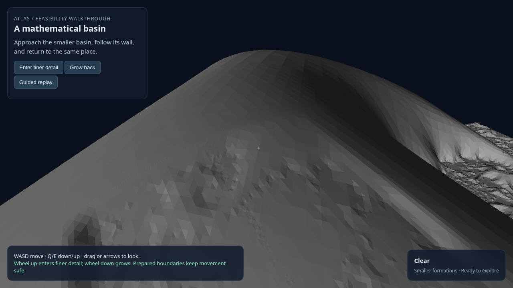
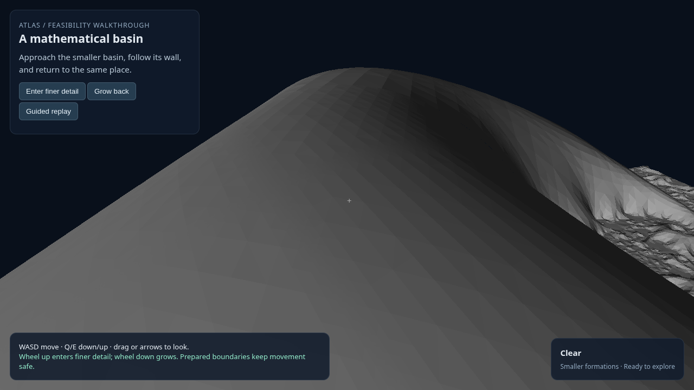

# PR9: readable mathematical relief and a failed wall prediction

**Additional mathematical relief is visibly demonstrated in one fixed world. My specific bright-wall prediction was wrong; it was not a North Star requirement.** I incorrectly treated that prediction as a gate on the demonstrated experience. The advisor challenged that judgement, and I have corrected the overall assessment. The unchanged working geometry is proceeding to broader navigation and regeneration checks; the original prediction result remains preserved.

Owner Codex; challenger Claude. Plan: [multiscale feature experience](../../superpowers/plans/2026-10-29-multiscale-feature-experience.md); governing [North Star](../../superpowers/specs/2026-10-23-atlas-north-star-charter.md). Scratch root: `/mnt/ml_storage/scratch/atlas-readability-pr9/`. [PR8](PR8-MULTISCALE-CONSTRUCTION-2026-10-29.md) remains closed with its original visual failure. No product source changed.

The [completed lifecycle continuation](PR9-LIFECYCLE-2026-10-29.md) now records the full navigation, preparation, identity and timing scorecard.

## Fixed comparison

PR9 reused world `H1C-surface-child@ee2564d40bda7ef6`, both body scales, all qualified meshes/colliders and the safe PR8 body path. It changed the observation and material: the view points at a mathematically selected feature; neutral grey uses orientation-correct face normals and one-sided Lambert lighting. The light was derived from the mathematical gradient before seeing images. There was no geometry, amplitude, seed or runtime-world change.

A deterministic row-major search of a frozen129×129 chart grid selected the first descendant-kernel g=.5 crossing. The profile, view, light,256pxROI and expected bright curved band were frozen before one headed capture pair. A sampled connected path to g≥.75 corroborated that the contour borders a deeper region; it did not prove a visible wall or a closed basin. The no-descendant control was diagnostic only and was never the ordinary navigation representation.

| Full fixed world | Offline no-descendant control |
|---|---|
|  |  |

The feature-centred ROI is available for the [full world](PR9-full-roi-2026-10-29.png) and [control](PR9-control-roi-2026-10-29.png). The unchanged large skyline ridge and right-hand groove are parent geometry. The additional faceted relief across the lower slope is attributable to the descendant. Neither peer could identify the exact declared bright curved band through the ROI centre.

## Full criteria scorecard

| Criterion | Target | Result |
|---|---|---|
| Fixed mathematical identity | Same full world at both scales | Met locally. Original rule/world/source hashes and geometry retained; static descriptors identify full world and source representation separately. No new construction. |
| Named feature selection | Deterministic mathematical feature before images | Selected exact g=.5 crossing; kernel depth100µm there. This establishes a depth contour, not a visible crest or wall. |
| Deeper-region relationship | Exposed path to g≥.75 | Supported finite check:205 refined samples, minimum g=.5, endpoint .75195; all sampled points exposed. No continuous connectivity/enclosure proof. |
| Safe view and geometric visibility | Covered body, clear approach,33 profile points visible | Passed existing-collider screen. Eye clearance .58593 smaller-body diameters; all33 rays visible within tolerance. Attribution displacement7.34–9.11px is eligibility only. Alternate eye unused. |
| Honest material and orientation | Actual outward normals; same camera/light/material in both images | Passed. All real triangle windings outward;64 independent mathematical side samples per mesh. No absolute-dot lighting, amplified normals, feature colours or fog. |
| GPU shader controls | Known front/reverse grey166/25, tolerance2 | Both exact:166 and25, same shader as world. |
| Render/collision geometry | Same actual positions/triangles during navigation | Bitwise expansion check passes all51,275 fine triangles.373 ordinary draw events have matching render/collision revisions.16 control draws explicitly marked diagnostic. |
| Exact visual criterion | Coherent brighter curved band through256pxROI centre, absent in control, identified by both peers | **Failed.** Control lacks descendant relief, but the named band is not identifiable. Frozen stop triggered; no visual tuning/rerun. |
| Broader visible relief | Additional mathematical geometry recognisable in matched comparison | **Supported partial finding.** Both peers identify local carved/faceted relief absent in control. General lighting, a coherent named basin, and arbitrary scales remain unestablished. |
| Fidelity/contact qualification | ≤.01 current-body diameters | PR8's finite mathematical qualification remains applicable to unchanged geometry; not rerun as a new global qualification. New original-profile check: maximum position discrepancy5.12µm, normal discrepancy2.30°. Does not qualify all image normals. |
| Local interaction and return | Safe shrink/contact/retreat/growth | Supported single smoke:1 contact,2 activations,1 cycle,1 unsafe-growth refusal,0 waits/errors, return to origin. No new full swept-body audit. |
| Resident reuse | Revisit prepared representation | Resident-reuse event observed; no field evaluation. Only retained qualified artifacts served. |
| Eviction/rebuild and reverse generation order | Same geometry/place after actual regeneration/opposite requests | **Not run.** Static reverse descriptor requests are not generation-order evidence. Existing PR8 rebuild evidence is not relabelled as PR9. |
| Frame rate | ≥30FPS overall and during preparation | **Full target unqualified.**8s capture/contact smoke48.99FPS overall; no native preparation occurred and screenshot pauses affect frame tails. No full3×90s corpus. |
| Navigation update | p99≤2ms; max≤8ms | Smoke diagnostic: p99**3.4ms misses**, max4.1ms meets. Not a full acceptance measurement. |
| Request-ready | ≤1s generation/preparation target | **Not measured for generation.** Retained-artifact fine load/index/restore191.7ms. It must not be compared as fresh world-generation latency. |
| Residency and memory | ≤4 regions; declared bounded caches;1GiB attributable region data | Peak2 residents. Renderer reports10.48MiB peak live GPU allocations; main/worker WASM capacities42.5/30.375MiB. **1GiB ownership unverified**; no native cache campaign here. |
| Actual keyboard/mouse and late preparation | Bounded input/control and3s-late recovery | **Not run** after visual stop. Guided replay is not actual input verification. |
| Execution and cleanup | Exclusive lock, explicit handoff, headed installed Chrome/NVIDIA profile/sandbox, bounded run, owned cleanup | Met. Shader controls and hardware identity checked; all12 recorded PIDs absent,5264closed, lockfree. |

## Why the specific criterion failed

After preserving both images and independent judgements, a CPU diagnosis checked the original33pointcross-section. Under the frozen light, mathematical normals predict a monotone grey ramp from79.72 to85.85. There is no interior brightness maximum at any of three finite-difference steps, H/256, H/512 and H/1024. The matched parent profile is also monotone,71.53 to74.54. The descendant adds a gentle brightness offset, not the claimed band.

The cross-section traverses five actual mesh faces. Their maximum positional difference from the mathematical profile is5.12µm and maximum normal disagreement2.30°. This supports a local experiment-definition error rather than a failed mesh/shader at that profile. It does not explain every rough feature elsewhere in the image or prove its slope fidelity.

I treated an arbitrary depth level as if it were a crest, crease or lighting maximum. The connected deeper region and projected displacement did not justify that assumption. Checking the expected mathematical shape and lighting before freezing the perceptual criterion would have caught it. A failed prediction of this kind does not refute multiscale generation or prepared navigation.

## Independent review and evidence tiers

Claude card review `20261029T202805Z-7821a7` requested connectivity and a specific visual expectation. Follow-up `20261029T203114Z-9deffd` accepted the finite connected-path evidence with its limits. Image review `20261029T203556Z-4ac0eb` inspected all four PNGs and the capture summary, independently supported the broader visible relief, and rejected the exact named-band claim. It did not inspect the full smoke JSON or the triangle-layout test. Diagnosis review `20261029T204412Z-15642d` inspected the diagnosis source/results and verified the original-profile interpretation and scope.

Established within the performed checks: preserved world/position identity, shader controls, local profile agreement, source hashes, matching ordinary render/collision revision events, and process cleanup. Supported partial findings: visible additional relief and one local interaction cycle. Unresolved: a recognisable named formation, full journey/input/late/regeneration-order behavior, general lighting, full performance and attributable memory. No product certification follows.

## Owner correction and next work

The advisor correctly observed increasing detail during zoom and challenged why I called the experiment a failure for an unspecified product requirement. I invented a particular bright-wall expectation, then gave it more weight than the actual goal and the positive evidence. Preregistering a criterion does not make it relevant. The failed prediction is useful diagnostic evidence; it does not erase the additional mathematical relief demonstrated by the matched images.

Correct status: visible additional mathematical detail demonstrated locally; that specific wall prediction wrong; broader interaction, regeneration, timing and memory checks incomplete. This is a useful first step toward the North Star. It is not a claim of unlimited recursion or a broader browser-ready world.

A separately frozen functional continuation in `journey-r1/card-r1.md` retains the working world, geometry, eye, light and material, and checks dynamic preparation, interaction, reuse/rebuild and opposite request order. It prospectively uses the demonstrated relief experience and preserves the original failed prediction, rather than changing that prediction's verdict. No new camera/light/ROI or mathematical specimen is needed for this next step. The alternative PR10 CPU specimens are preserved and parked before any geometry/browser construction or external review; their approval question is no longer needed for the current work. BW1 remains deferred until this local lifecycle result is reported.

Work began around20:13UTC; images/evidence review finished20:36. After daemon recovery20:42, local diagnosis, review and closure finished around20:48, inside the60minute card bound. Freeze-before-image, normal controls and independent image assessment were useful. The preventable cost was requiring a bright band without first asking the mathematics whether it predicts one. No full performance rerun was warranted. Product tests were unaffected; no commit, push or promotion occurred.

Scratch evidence includes `card-r0.md`, `amendment-r1.md`, `expectation-r2.md`, `feature-r0.json`, `connectivity-r0.json`, `view-r0.json`, `normal-controls-r0.json`, `normal-layout-test-r0.json`, `smoke-r0.json`, `server-smoke-r0.json`, `closure-audit-r0.json`, `profile-diagnosis-r0.json`, owner judgement, all review results and `closure-manifest-r0.json`.
